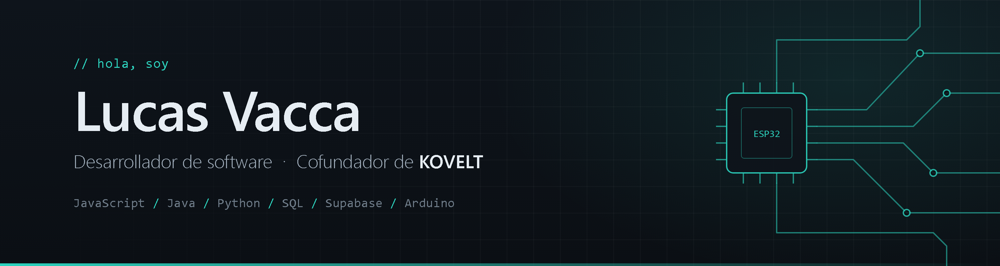

Desarrollador de software y cofundador de KOVELT.

Me gusta programar y llevar ideas a proyectos que funcionen, desde aplicaciones web hasta dispositivos con ESP32. Hoy reparto mi tiempo entre KOVELT, una tienda online que desarrollamos en equipo y un asistente de voz.

Podés ver mis proyectos en mi portfolio: [lucass291.github.io](https://lucass291.github.io)

## Tecnologías

- **Lenguajes:** JavaScript, HTML, CSS, Java, Python, SQL
- **Datos:** Supabase, JSON, manejo de datos en Excel
- **Control de versiones:** Git, GitHub
- **Electrónica:** Arduino, ESP32

## Proyectos

### KOVELT
Emprendimiento tecnológico que cofundé, dedicado al desarrollo de software y soluciones digitales.

### E-commerce
Tienda online desarrollada en equipo, con registro e inicio de sesión de usuarios, base de datos, gestión de productos y carrito de compras.

### Asistente de voz
Asistente basado en ESP32 en el que combino programación y electrónica.

## En qué me estoy enfocando

Arquitectura de software, desarrollo web y sistemas embebidos.

## Contacto

- Portfolio: [lucass291.github.io](https://lucass291.github.io)
- Email: [lucasvacca7@gmail.com](mailto:lucasvacca7@gmail.com)
